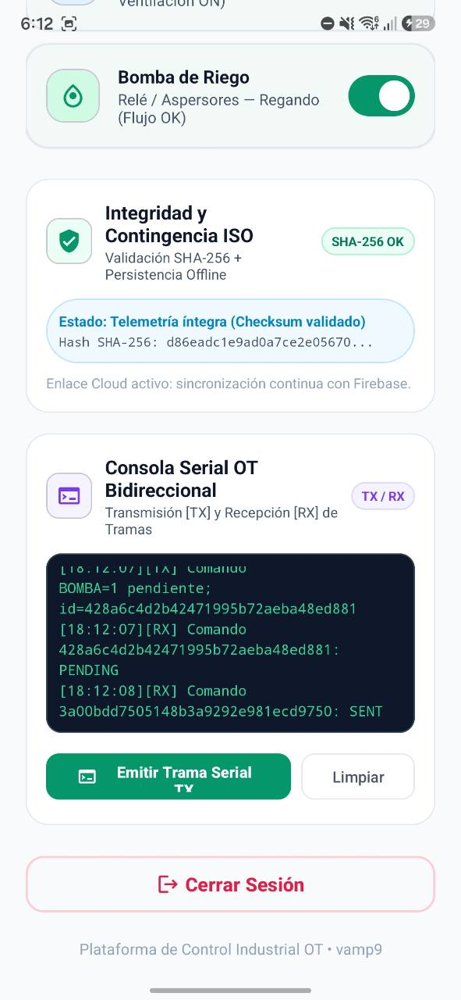

# IoTClimaRiego · Evaluación 3

Prototipo de invernadero IoT con aplicación Android, ESP32 simulado en Wokwi, Firebase y AWS IoT Core. La bomba se representa mediante un LED.

### Vista de la aplicación

## Arquitectura

ESP32 → MQTT con TLS → AWS IoT Core → DynamoDB. Un gateway Python conecta MQTT con Firestore; la aplicación Android utiliza Firebase Authentication y Firestore para visualizar lecturas y enviar órdenes.

## Componentes

- `app/`: aplicación Android.
- `wokwi_esp32/`: firmware, circuito y plantilla de configuración.
- `gateway_raspberrypi/`: puente entre AWS IoT y Firestore.
- `firebase/`: reglas de ejemplo.

## Configuración

1. Configura tu propio proyecto Firebase, activa autenticación por correo y contraseña y coloca tu `google-services.json` en `app/`.
2. Publica y adapta las reglas de Firestore a tu proyecto y operadores autorizados.
3. Copia `wokwi_esp32/config.example.h` a `config.h` y configura tu dispositivo y certificados AWS IoT.
4. Crea un entorno Python `.venv` en la raíz, instala las dependencias de `gateway_raspberrypi/requirements.txt`, copia `gateway_raspberrypi/config.example.env` a `.env` dentro de `gateway_raspberrypi/` y configura una cuenta de servicio Firebase y credenciales AWS IoT independientes para el gateway.
5. Compila el firmware con PlatformIO, inicia Wokwi, ejecuta el gateway e instala la aplicación Android.

No publiques claves privadas, certificados de dispositivo, cuentas de servicio ni archivos de configuración locales. Cada instalación requiere sus propias credenciales y políticas apropiadas.

## Alcance

El DHT22 mide temperatura y humedad ambiental; el riego automático usa esta última como indicador simulado. El búfer del ESP32 está en RAM y se pierde al reiniciar. El checksum detecta alteraciones accidentales, pero no autentica el origen. La comunicación serial de Android se representa mediante el gateway y MQTT, no mediante USB directo.

Las mediciones físicas de consumo y el vaciado del búfer tras una caída del nodo no se han verificado. El comportamiento depende de la configuración y permisos de los servicios externos.
